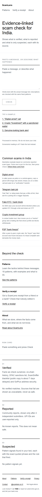
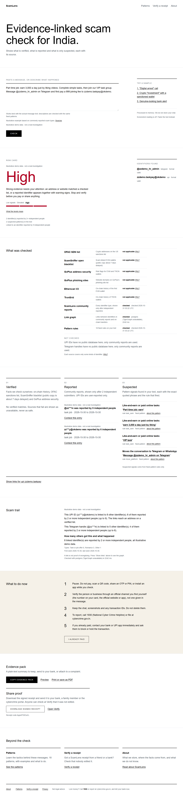
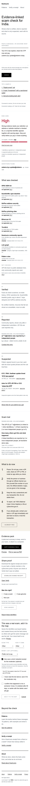
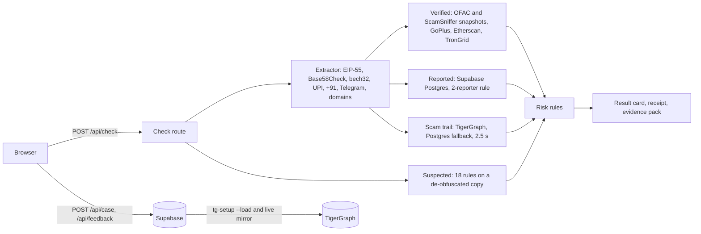

<p align="center"></p>

# ScamLens

**Evidence-linked scam check for India.** Paste a message, or describe what happened. ScamLens shows what is verified, what other people reported and what is only suspected, each with its source, and never gives a verdict about a person.

**Live:** https://scam-lens-two.vercel.app · No account, no login · Hacker House Goa 2026 (Crypto x AI track, team ArcReap)

<p align="center">
  
  
  
</p>

## The problem

People in India get "digital arrest" calls, like-and-earn job offers, fake KYC links, crypto "investment" groups and P2P "bank freeze" threats every day. The usual answers are a generic warning or a black-box "scam / not scam" score. Neither says *why*, neither separates a checked fact from a claim, and a wrong verdict harms the person who was labelled.

## What it does

One box, one result, three kinds of evidence that are never mixed:

| Tier | What it means | Where it comes from |
|---|---|---|
| **1. Verified** | Facts ScamLens checks itself, each with source, date and a link to check it yourself | OFAC SDN list, ScamSniffer open address list, GoPlus address security and phishing sites, Etherscan V2 (<!-- FACT:free_chains -->Ethereum, Polygon, Arbitrum One<!-- /FACT --> on the free plan), TronGrid |
| **2. Reported** | Community reports, shown only after <!-- FACT:min_reporters -->2<!-- /FACT --> independent reporters within 90 days | ScamLens' own database (keyed hashes and masked forms only) |
| **3. Suspected** | Warning patterns in *your* text, with the exact quoted words and the rule that fired | <!-- FACT:rule_count -->18<!-- /FACT --> fixed rules (AI is off by decision) |

**Worked example.** Paste *"This is an officer from the cyber crime branch... you are under digital arrest... Transfer your savings to the RBI verification account within 2 hours: zzdemo.cbi.verify@okdemo"* (one of the labelled examples on the home page). The result:

- **Suspected:** "digital arrest" and "urgency", each with the quoted words underlined.
- **Reported:** the UPI ID is reported by several independent people (illustrative demo data), so the level is **High** (reports together with warning signs).
- **Scam trail:** the UPI ID links to other reported identifiers, shown as counts of linked cases, by type, channel and month.
- **What to do now:** pause, verify through an official channel, call **1930** or report at cybercrime.gov.in, and tell your bank.
- **Share proof:** a signed receipt anyone can verify at `/verify`.

### How the level is decided

| Level | When |
|---|---|
| **High** | at least one Verified match, **or** an identifier reported by 2+ independent people **and** at least one counted warning pattern |
| **Elevated** | warning patterns or reports that do not reach High; or a link (scam trail) to an identifier reported by 2+ independent people |
| **Low signals** | nothing found; always "This does not mean safe" |

Patterns alone can never produce High, so a new scam that nobody has reported yet usually shows Elevated; the card explains this under "What the levels mean". A source that fails is shown as **unavailable**, never as clean. Contested reports stay visible, labelled "Contested, under review", and never count toward High. A pattern inside a sentence that warns about scams ("never share your OTP", "News: police said...") is shown but not counted.

### Scam trail and community loop

- **Scam trail:** every check also looks up, within 2.5 s, which reported identifiers its UPI IDs, wallets and handles are linked to (TigerGraph, with a labelled Postgres fallback), and shows counts only, with "A link is not proof of wrongdoing."
- **Was this right?** Scam, genuine or not sure, with fixed reasons; shown as counts next to Reported entries and never a change of level.
- **This was a real scam, add it to the map:** optional, with consent: type, channel, money lost, month and the patterns that fired; an excerpt only if you tick it twice after reading the redacted text; a delete code shown once. See [docs/PRIVACY.md](docs/PRIVACY.md).

## Architecture



More: [docs/ARCHITECTURE.md](docs/ARCHITECTURE.md) (sequence, data model, deployment, failure behaviour), [docs/API.md](docs/API.md) (<!-- FACT:route_count -->20<!-- /FACT --> routes and files), [docs/DATA-MODEL.md](docs/DATA-MODEL.md).

## Tech stack

| Part | Choice | Why |
|---|---|---|
| App | Next.js 16 (App Router), React 19, TypeScript | one deployable for pages and API routes; server code keeps every key off the browser |
| Styling | Tailwind CSS 4 with Swiss-style tokens | small CSS, enforced palette and contrast in tests |
| Validation | zod | the same schemas validate requests, responses and receipts |
| Database | Supabase (Postgres) | reports, cases, feedback and usage counters with SQL functions and row-level security |
| Link graph | TigerGraph Savanna | multi-hop link queries (Q1-Q4) with a hub filter; Postgres recursive CTEs answer the same queries as a fallback |
| Crypto checks | viem, bs58check, tldts | checksums and domain parsing without guesswork |
| Tests | Vitest, PGlite (Postgres in WebAssembly) | the real SQL runs in tests without a server |
| Hosting | Vercel | preview and production builds from git |

## Data sources and licences

- **OFAC SDN list** (US Treasury): public domain; snapshot date on every row.
- **ScamSniffer scam-database** ([github.com/scamsniffer/scam-database](https://github.com/scamsniffer/scam-database)): address list, GPL-3.0, with attribution; about 7 days behind ScamSniffer's live feed. Its domain list is too large for this deployment and is not used.
- **GoPlus** address security and phishing-site APIs, **Etherscan V2** and **TronGrid**: queried live, subject to their terms. Only the registrable domain of a website is sent to GoPlus.
- Helpline **1930** and **cybercrime.gov.in**: Indian Cyber Crime Coordination Centre (I4C), Ministry of Home Affairs.
- Full list with versions: [docs/THIRD_PARTY.md](docs/THIRD_PARTY.md).

## Privacy and security

Your check is never stored. If you choose to contribute a case, we store structured facts and, only if you tick it, a redacted excerpt you reviewed, visible only to the moderator, deleted with your delete code or after 90 days.

- Identifiers are stored only as keyed hashes (HMAC with a server secret) and masked forms; network addresses only as keyed fingerprints.
- Logs hold an event name, a status and a duration (tested). Strict security headers; every key stays on the server.
- Daily per-network limits on every route that does work or writes.
- Details: [docs/PRIVACY.md](docs/PRIVACY.md), [SECURITY.md](SECURITY.md), [docs/knowledge/10-SECURITY-AND-ABUSE.md](docs/knowledge/10-SECURITY-AND-ABUSE.md).

## Contact

- Email: <!-- FACT:contact_email -->scamlenspvt@gmail.com<!-- /FACT --> (corrections, report or contest requests, deletion requests, feedback)
- X: <!-- FACT:x_handle -->@scamlens<!-- /FACT --> (<!-- FACT:x_url -->https://x.com/scamlens<!-- /FACT -->)
- Security issues: [SECURITY.md](SECURITY.md) (GitHub private vulnerability reporting first).

ScamLens cannot recover money. If you lost money, call 1930 now and tell your bank.

## Testing and evaluation

- **Tests:** <!-- FACT:test_files -->40<!-- /FACT --> test files with <!-- FACT:test_declarations -->473<!-- /FACT --> test declarations (Vitest; `it.each` expands to more when run). They use mocked network calls, PGlite with the real SQL, and never call a live API.
- **Eval (rules only):** <!-- FACT:eval_cases -->83<!-- /FACT --> synthetic, hand-written labelled chats in `eval/chats.json`: precision <!-- FACT:eval_precision -->100.0%<!-- /FACT -->, recall <!-- FACT:eval_recall -->100.0%<!-- /FACT -->, <!-- FACT:eval_fp -->0<!-- /FACT --> false positives, <!-- FACT:eval_fn -->0<!-- /FACT --> false negatives ([eval/RESULTS.md](eval/RESULTS.md)).
- **QA scenarios:** 12 long synthetic scenarios with written hypotheses, each difference marked bug or by design ([eval/qa-scenarios.md](eval/qa-scenarios.md)).
- **Live smoke:** `scripts/smoke-live.ts` runs <!-- FACT:smoke_expectations -->39<!-- /FACT --> expectations; `scripts/check-headers.ts` checks the security headers.

**What the eval is not.** The same people wrote the rules and the chats, and several cases were added after the fixes they test, so the numbers show the rules behave as designed on known phrasings. They are not a real-world accuracy claim.

## Run it locally

```
cd web
npm ci
cp .env.example .env.local       # names only; every value is optional for a first run
npm run dev                      # http://localhost:3000
npm test; npm run typecheck; npm run lint; npm run build
npm run docs:generate; npm run docs:check
npm run eval                     # writes eval/RESULTS.md
npx tsx scripts/seed-india-cases.ts --local   # demo dataset in an in-memory Postgres
```

Environment variable names and what each does: the generated table in [docs/knowledge/13-OPERATIONS.md](docs/knowledge/13-OPERATIONS.md). Deployment, SQL order (migrations <!-- FACT:db_migrations -->`002_contest_policy.sql`, `003_contest_retention.sql`, `004_cases_and_feedback.sql`<!-- /FACT -->) and TigerGraph setup: [docs/DEPLOY.md](docs/DEPLOY.md).

## Project structure

```
web/                    Next.js app (Vercel root directory)
  src/app/              pages (/, /about, /patterns, /verify, /privacy) and API routes
  src/lib/              extractor, verified sources, signals, risk, reports, cases, trail, graph, receipts
  db/                   schema.sql, supabase-grants.sql, migrations/
  data/                 OFAC and ScamSniffer snapshots
  scripts/              smoke tests, header check, seeders, tg-setup, docs tooling, brand export
graph/                  TigerGraph schema, queries and migrations
eval/                   labelled chats, QA scenarios, synthetic dataset, results
docs/                   knowledge base, privacy, dataset, architecture, API, data model, deploy, moderation
```

## Illustrative demo data

The live Reported tier, the link graph and the scam trail hold **synthetic demo data only**, labelled "Illustrative demo data" wherever it appears: the original scenario and 56 cases in 10 campaigns modelled on publicly reported Indian scam types ([docs/DATASET.md](docs/DATASET.md)). Every identifier is synthetic (`zzdemo.*@okdemo`, `@zzdemo_*`, `example.com`, wallets from random discarded keys). Sample 2 uses one real address from the public OFAC list so the Verified tier can be shown live; the chat around it is invented.

## Limitations and roadmap

- Not a complete scam database and not a safety guarantee; UPI IDs, phone numbers, Telegram handles and emails have no verified source here, and website domains are checked against GoPlus's phishing-site list only.
- No accounts: independence is a keyed network fingerprint, so people on one network count once and one person on several networks can count more than once.
- Rules are English-first with a small Hinglish set; a request phrased without the listed verbs does not defeat a warning marker in the same sentence.
- Contributing needs migration 004 on the database (a human step); moderation is by hand in the SQL editor ([docs/MODERATION.md](docs/MODERATION.md)).
- Open items and owner steps: [docs/HUMAN_TASKS.md](docs/HUMAN_TASKS.md); gaps: [docs/knowledge/16-KNOWN-GAPS-AND-ROADMAP.md](docs/knowledge/16-KNOWN-GAPS-AND-ROADMAP.md).
- Nothing here is legal advice.

## Acknowledgements and data licences

OFAC SDN list (US Treasury, public domain); ScamSniffer scam-database (GPL-3.0, attribution kept); GoPlus Security, Etherscan and TronGrid APIs (their terms); TigerGraph Savanna and Supabase (hosted services). The repository has no licence file yet; the owner will choose one (see docs/HUMAN_TASKS.md).
