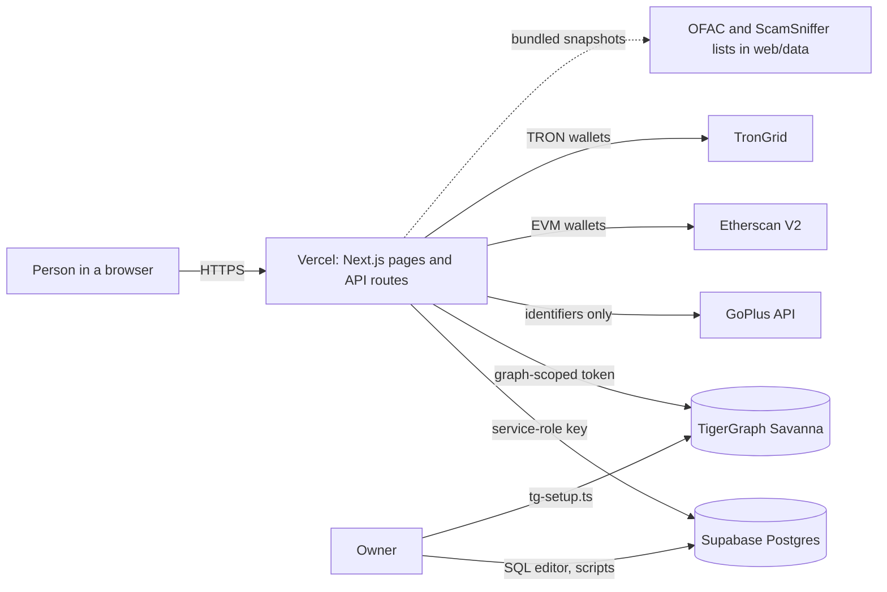
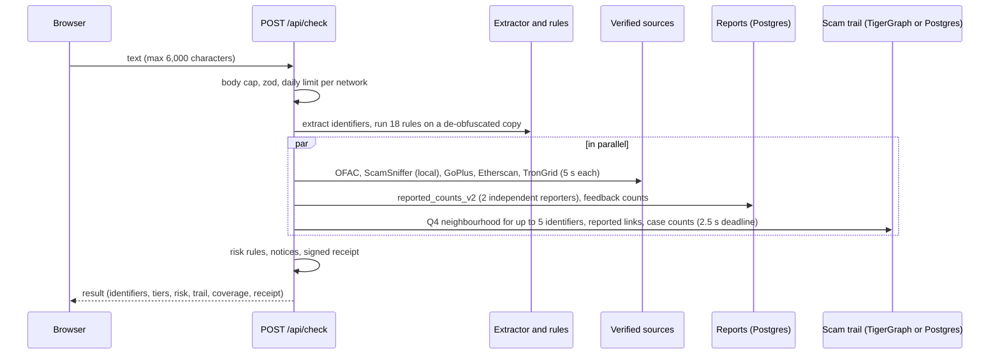
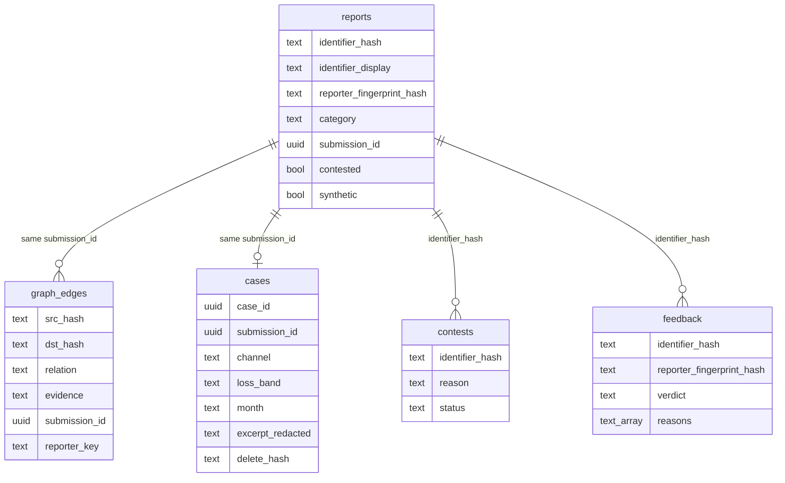
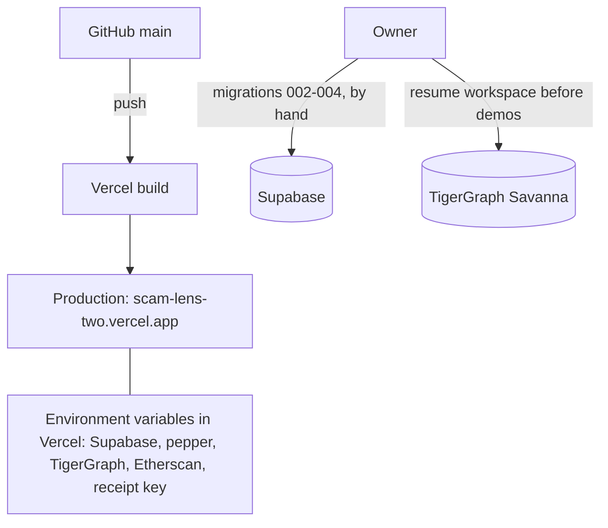

# Architecture

ScamLens is one Next.js app on Vercel. Pages render on the server (the home page is a partial prerender: a static shell with the form streamed); API routes do the work. Supabase (Postgres) is the system of record; TigerGraph holds the link graph, with Postgres answering the same queries as a labelled fallback. Nothing in the browser holds a key.

## System context

## One check, step by step

Typical times measured on 2026-10-30/31: rules-only parts in milliseconds; verified sources 0.2-1.5 s (Etherscan with rate limits can take several seconds for a first wallet); the scam trail 0.6-1.8 s against live TigerGraph. A check that hits a source's timeout shows that source as unavailable.

## Data model

TigerGraph schema (`graph/schema.gsql`): vertices `Wallet`, `UPI`, `TelegramHandle`, `PhoneNumber`, `Domain` (each keyed by the identifier hash, with a masked display) and `Report` (keyed by submission id, with a pseudonymous reporter key); edges `MENTIONS` (report to identifier) and `PAID` (wallet to wallet). Tables, functions and migrations: [DATA-MODEL.md](DATA-MODEL.md).

## Deployment

## Failure behaviour

| What fails | What the person sees | What never happens |
|---|---|---|
| A verified source (timeout, error, bad answer) | that row says "unavailable" with the reason; "result is incomplete" | the source counted as "no match" |
| The reports database | "Reports database unavailable ... This is not a clean result." | "No known reports" |
| TigerGraph | the trail and the graph answer from Postgres, labelled "postgres (TigerGraph unavailable)" | silent switch |
| The trail deadline (2.5 s) | notice "The scam trail ... could not be checked this time" and the Link graph row "unavailable" | a lowered level |
| Migration 004 missing | "Contributing is not available right now."; trail counts come from reports | lost checks |
| Daily limit reached | HTTP 429 with Retry-After and a plain sentence | any external call |
| The receipt key missing | no receipt and no Share proof step | an unsigned "receipt" |
